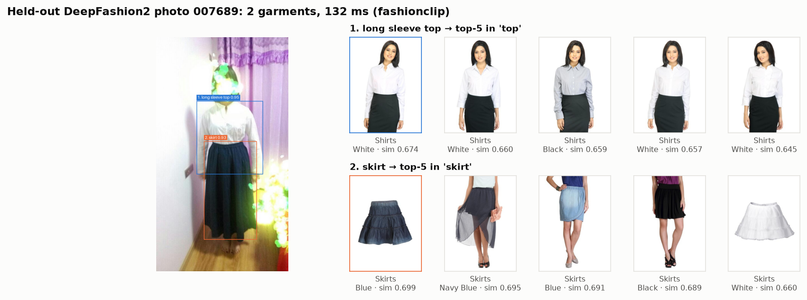
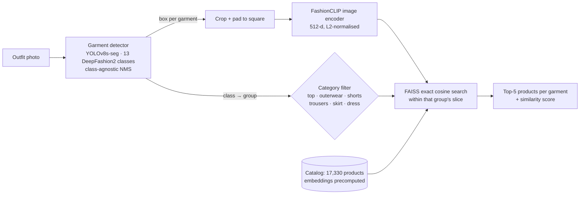
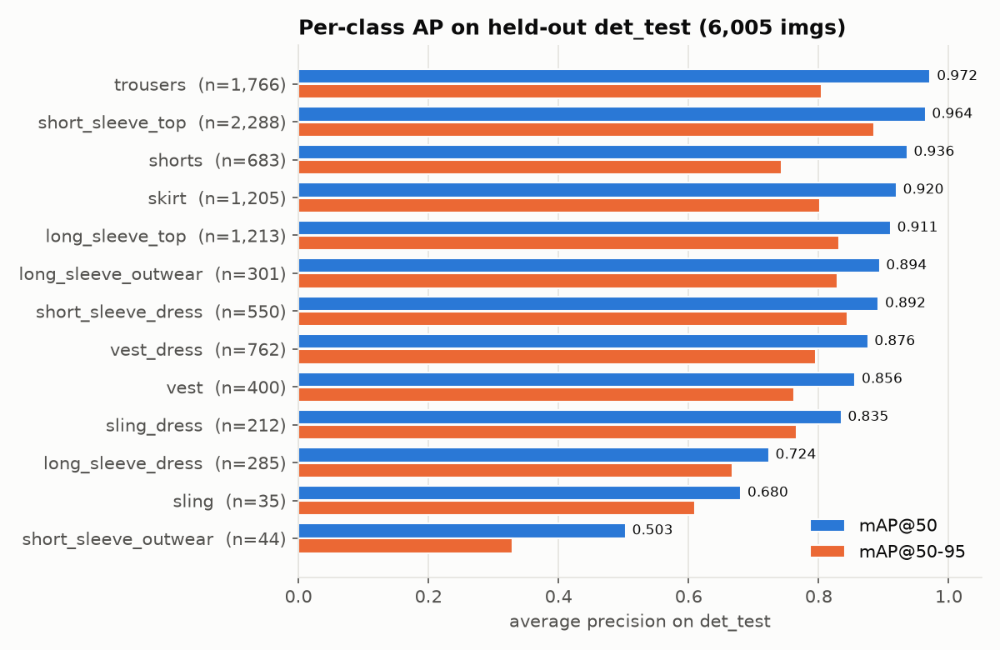
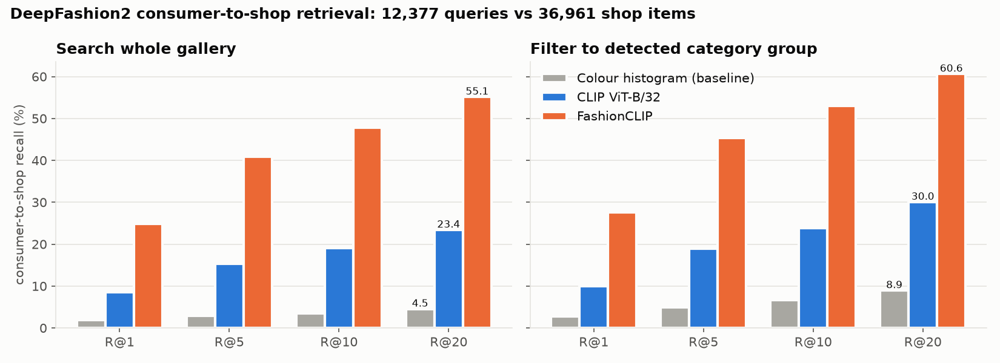

# ShopTheLook: shop an outfit from a photo

**Upload an outfit photo → each garment is detected → the most similar catalog products are shown for each one.**
A fashion-tech prototype built as a product: working ML pipeline, offline evaluation with real
measured numbers, PRD, metrics framework and A/B test plan.


<sub>Real pipeline output on a held-out DeepFashion2 photo (not used in any training we did): detected garments (left) and top-5 catalog products per garment with cosine similarity.</sub>

---

## The problem

Shoppers discover fashion visually (Instagram posts, street style, a friend's outfit), but buy
through **text search**. Turning "that olive cropped jacket" into the right query is slow and often
fails. People reformulate, give up, or buy the wrong thing and return it. An outfit is also 2–4
garments, and text search makes you repeat the effort for each one.

**Shop the Look** makes the photo the query. See [docs/PRD.md](docs/PRD.md) for personas, user stories, scope, risks and rollout.

## How it works



| Stage | Choice | Why |
|---|---|---|
| Detection | Pretrained DeepFashion2 **YOLOv8s-seg** ([Bingsu/adetailer](https://huggingface.co/Bingsu/adetailer)), **not trained by us**, evaluated on our held-out split | Fastest path to a strong detector. We planned to fine-tune YOLO11n (notebook included, smoke-tested) but switched to save time. See [docs/DETECTION.md](docs/DETECTION.md) |
| Embedding | **FashionCLIP**, chosen over OpenAI CLIP ViT-B/32 and a colour-histogram baseline | Best measured retrieval (below), same architecture and cost as CLIP |
| Retrieval | FAISS `IndexFlatIP`, one sub-index per category group | Exact search on 17k vectors takes < 1 ms, so an ANN index isn't needed yet |
| Catalog | Kaggle *Fashion Product Images* (originally Myntra products), 17,330 apparel items | Public, MIT-licensed, real e-commerce product shots |

## Results (all measured, see [results/RESULTS.md](results/RESULTS.md))

**Detection**: 6,005 held-out DeepFashion2 photos (9,744 garments), Apple M4

| | box mAP@50 | box mAP@50-95 |
|---|---:|---:|
| vs official DF2 bounding boxes | **0.842** | **0.636** |
| vs polygon-derived boxes (Ultralytics seg format) | 0.843 | 0.744 |

Best classes: trousers 0.972, short-sleeve top 0.964 (AP@50). Worst: short-sleeve outerwear **0.503** (only 44 test boxes) and sling 0.680.


**Retrieval**: DeepFashion2 consumer-to-shop, 12,377 consumer-photo garments searched against 36,961 shop-photo garments (ground-truth crops)

| Embedding | Category filter | Recall@1 | Recall@5 | Recall@10 |
|---|---|---:|---:|---:|
| Colour histogram (baseline) | yes | 2.76% | 4.91% | 6.67% |
| CLIP ViT-B/32 | yes | 10.03% | 18.96% | 23.77% |
| **FashionCLIP** | **yes** | **27.56%** | **45.29%** | **53.07%** |
| FashionCLIP | no | 24.80% | 40.95% | 47.80% |



**Against the product catalog**

| Embedding | Wrong-category share of top-5 *without* the filter | Same articleType @5 | Same colour @5 |
|---|---:|---:|---:|
| Colour histogram | 62.5% | 58.4% | **54.6%** |
| CLIP ViT-B/32 | 56.5% | 86.2% | 33.6% |
| FashionCLIP | **34.6%** | **89.7%** | 41.2% |

**Latency**: end-to-end per photo (detect + crop + embed + search), 200 held-out photos after warm-up, Apple M4 (MPS): **median 38.4 ms, p95 48.9 ms** (detect 22.9 ms, embed 13.0 ms, search 0.63 ms median). Excludes upload, network and JPEG decoding.

### What the numbers say (product reading)
1. **A domain-specific embedding is the biggest lever.** FashionCLIP more than doubles Recall@10 over general CLIP (53.1% vs 23.8%) at the same cost.
2. **The category filter is not optional.** Unfiltered, a third of FashionCLIP's catalog results are the wrong garment type, and 73% for jacket queries, because the catalog has only 280 outerwear items.
3. **Embeddings under-weight colour.** A plain colour histogram matches colour more often than FashionCLIP (54.6% vs 41.2%). A colour-aware re-rank is the obvious next experiment.
4. **Catalog coverage is a product risk.** 82% of the catalog is tops, and there are only 114 skirts. Great matching can't make up for missing stock.

### Honest caveats
* **We did not train the detector.** The weights are third-party. The model card doesn't say which DeepFashion2 splits were used. As evidence that our test split is held out, the model scores clearly higher on DF2-*train* images (mAP@50 0.941) than on our test images (0.843). That supports, but doesn't prove, no contamination.
* Retrieval Recall@k uses **ground-truth crops** to isolate embedding quality. End-to-end recall with detector crops would be somewhat lower.
* DeepFashion2 consumer-to-shop pairs reward the *exact* item. Shoppers who are happy with *similar* items may rate quality higher than Recall@k suggests. Human relevance ratings are future work.
* Mask mAP is unexpectedly lower on the train sample than on test. It's unexplained (likely our polygon conversion) and doesn't affect the pipeline, which only uses boxes.
* **Not measured: fairness across skin tones and body types.** DeepFashion2 has no such labels. The PRD makes a consented, labelled evaluation set a launch gate.
* Latency is laptop inference, not a production server under load.

### A bug we found and fixed
The same denim garment came back as both "shorts" and "skirt", because per-class NMS keeps overlapping boxes of different classes.
Switching to **class-agnostic NMS** (one garment → one box) cut detected items per photo from 1.54 to 1.40.
[Before](results/demo/failure_duplicate_boxes_before_agnostic_nms.png) → [after](results/demo/example_1.png).

## Product docs

| Doc | What's inside |
|---|---|
| [docs/PRD.md](docs/PRD.md) | Problem, personas, user stories, scope and non-goals, key flows, risks (wrong-category, bias, catalog coverage, latency), prototype evidence, phased rollout |
| [docs/METRICS.md](docs/METRICS.md) | North Star (ATC rate from look recommendations), funnel and driver metrics, guardrails (returns, p95 latency, bounce), offline→online mapping |
| [docs/AB_TEST.md](docs/AB_TEST.md) | Hypothesis, text-search control vs Shop-the-Look treatment, user-level randomization, MDE, **203,322 users/arm, 14 days**, ship/iterate/kill rules |
| [analysis/power_analysis.py](analysis/power_analysis.py) | Sample size and duration calculator (closed form, cross-checked with statsmodels) |
| [analysis/simulated_ab_test.ipynb](analysis/simulated_ab_test.ipynb) | **SIMULATION on synthetic data**: SRM check, lift + CI, triggered analysis, CUPED, guardrails, Monte Carlo power check. Not real results |
| [docs/wireframes/shop_the_look_wireframe.html](docs/wireframes/shop_the_look_wireframe.html) | Upload screen and per-item results screen, annotated with product decisions |
| [docs/DATA.md](docs/DATA.md) · [docs/DETECTION.md](docs/DETECTION.md) | Datasets, subsets, licenses · detector choice, pickle safety check, evaluation details |

## How to run

**Demo (one command):**
```bash
bash run_demo.sh        # first run sets everything up (~1.5 GB download), then opens http://127.0.0.1:7860
```
`setup.sh` creates a Python 3.12 venv, installs pinned requirements, fixes a macOS OpenMP clash
between torch and faiss, downloads the detector (SHA-256 verified) and the catalog, and embeds
the catalog with FashionCLIP. The demo doesn't need DeepFashion2.

**Reproduce the evaluation** (needs DeepFashion2, ~2.7 GB; see [docs/DATA.md](docs/DATA.md)):
```bash
.venv/bin/python -m src.data.prepare_df2 --train-subset 15000 --val --yolo --yolo-seg --items
.venv/bin/python -m src.eval.detection_eval --weights models/deepfashion2_yolov8s-seg.pt --data data/df2_yolo_seg/df2_seg.yaml
.venv/bin/python -m src.eval.detection_eval_official_boxes
.venv/bin/python -m src.eval.retrieval_eval --models color_hist clip fashionclip
.venv/bin/python -m src.build_index --models color_hist clip fashionclip
.venv/bin/python -m src.eval.catalog_eval
.venv/bin/python -m src.eval.latency --model fashionclip
.venv/bin/python -m src.eval.report          # -> results/RESULTS.md + charts
.venv/bin/python -m pytest -q                # 12 tests: index, retrieval, pipeline
```
Seeds are fixed (42), and every data split is a committed file list in `splits/`.

## Repository layout
```
src/            detect.py · embed.py · index.py · retrieve.py · pipeline.py · build_index.py · download_weights.py
src/data/       DeepFashion2 + catalog preparation (partial download of train.zip via HTTP range requests)
src/eval/       detection, retrieval, catalog, latency, report, demo figures
app/app.py      Gradio demo
notebooks/      optional Colab notebook to fine-tune YOLO11n yourself (not used for reported results)
analysis/       power analysis + simulated A/B notebook
docs/           PRD, METRICS, AB_TEST, DATA, DETECTION, wireframes/
results/        every metric as CSV/JSON + charts
splits/         exact image lists for every split
tests/          pytest
```

## Limitations and future work
* **Colour-aware re-ranking**: blend FashionCLIP similarity with a colour term. Colour is the measured weakness.
* **Fine-tune the embedding on consumer-to-shop pairs**: DF2 train pairs could close the street-photo vs studio-shot gap.
* **End-to-end retrieval eval with detector crops**, and human relevance ratings for "similar, not identical".
* **Bias evaluation set** with consented skin-tone (Monk scale) and body-size labels. **Indian ethnic wear** (kurta, saree, lehenga) is missing from the DeepFashion2 taxonomy.
* Accessories and shoes, text + image queries ("this, but in blue"), personalised ranking.
* Production: owned training data and a commercial detector license (Ultralytics models are AGPL-3.0), GPU serving, ANN index for million-item catalogs.

## Data and licenses
* **DeepFashion2**: research use only. Access officially goes through the authors' request form. We used an unofficial unencrypted Hugging Face re-upload, so anyone reproducing this should submit the official form.
* **Fashion Product Images** (Kaggle, Param Aggarwal): MIT. The product photos belong to the retailer and brands, so use them for demo and research only.
* **Detector weights**: Bingsu/adetailer (Apache-2.0 repo), with an Ultralytics AGPL-3.0 notice on the checkpoint.
* **FashionCLIP** ([patrickjohncyh/fashion-clip](https://huggingface.co/patrickjohncyh/fashion-clip)) and **CLIP** (OpenAI) from Hugging Face.
